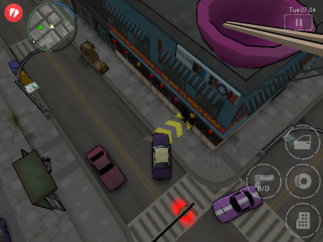
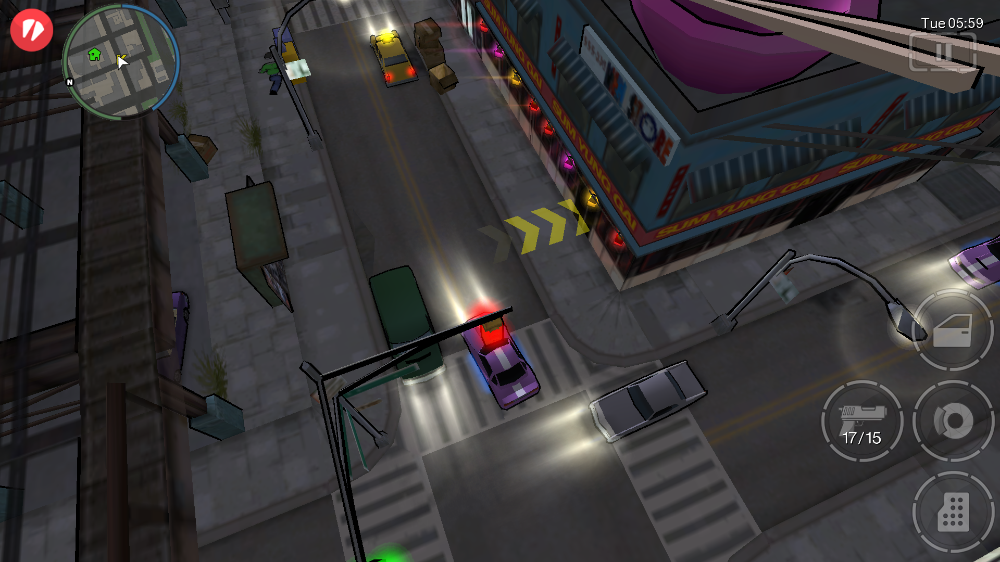

# ctw-android

Port of **GTA: Chinatown Wars** (Android) to GNU/Linux, via an so-loader that
loads the Android `libGame.so` inside a glibc process (fake JNI/EGL
environment + overridden system hooks).

Two target architectures are supported from a single source tree:

- **aarch64:** the original port, loads the Android aarch64 `libGame.so`
- **x86_64:** loads the Android x86_64 `libGame.so`

## Screenshots



*Running on RG 28XX (Mali-G31 / Panfrost) with ROCKNIX*



*Running on GNU/Linux x86_64 (AMD Radeon, Mesa)*

## Requirements

- Game files from a legitimate copy of **GTA: Chinatown Wars** for Android
- CMake (>= 3.10)
- C11 and C++14 compatible compiler (GCC/Clang)
- SDL2
- EGL / OpenGL ES 2.0
- OpenAL
- libmpg123

### Per-architecture dependencies

The **aarch64** target additionally requires FFmpeg
(libavformat / libavcodec / libswresample / libavutil) for the cutscene
movie player. The x86_64 target does not.

### Installing dependencies

**Debian / Ubuntu / Linux Mint:**
```bash
sudo apt update
sudo apt install build-essential cmake libsdl2-dev libopenal-dev libmpg123-dev \
                 libegl1-mesa-dev libgles2-mesa-dev \
                 libavformat-dev libavcodec-dev libswresample-dev libavutil-dev
```

**Arch Linux:**
```bash
sudo pacman -S base-devel cmake sdl2 openal mpg123 mesa ffmpeg
```

## Game Files Layout

Obtain the binaries (`libGame.so`, `libc++_shared.so`) and asset archives from
the Android APK/OBB.

Place the compiled `ctw` executable in the root directory alongside your game
files:

```text
.
├── assets/
│   ├── dxt.bin
│   ├── game.pak
│   ├── rom.toc
│   ├── rom.wad
│   └── ...            (any other loose assets the APK ships)
├── ctw
├── libc++_shared.so
└── libGame.so
```

> `check_data` requires `libGame.so`, `libc++_shared.so` (the C++ runtime donor)
> and `assets/game.pak`; the engine also opens `rom.toc`, `rom.wad`, `dxt.bin`
> and other loose assets from `assets/`.

## Build

The architecture is detected automatically from the build host
(`CMAKE_SYSTEM_PROCESSOR`). To build for the host, run:

```bash
mkdir build
cd build
cmake ..
make
```

To build explicitly for one architecture (useful when the build directory is
shared between machines, or when cross-compiling):

```bash
cmake -DCTW_ARCH=aarch64 ..
```

or

```bash
cmake -DCTW_ARCH=x86_64 ..
```

Shared sources live in `src/`; the divergent per-architecture loader, import
tables and entry points live in `arch/aarch64/` and `arch/x86_64/`.

After building, copy the `ctw` binary to the directory containing your game
assets and shared libraries (`.so` files). The binary must match the
architecture of the extracted `libGame.so`: the aarch64 build loads the
Android aarch64 game library, the x86_64 build the Android x86_64 one.

## Run

Navigate to the directory containing your game files and executable, then run:

```bash
./ctw
```

### Optional environment variables

- `CTW_W`, `CTW_H` — run windowed at a custom size instead of fullscreen-desktop
  (useful on weak GPUs: e.g. `CTW_W=960 CTW_H=540 ./ctw`).
- `CTW_MSAA` — multisampling samples (0 = off).
- `CTW_MODEL` — value reported for the Android `model` device property.
- `CTW_PHONE` — set to `1` to report the device as a phone instead of a tablet
  (the default); affects the game's UI layout mode.
- `CTW_LOCALE` — game language index passed to the game's locale query
  (default `0` = English, `1` = French...).
- `CTW_MUSIC_DIR` — extra directory scanned for custom MP3 soundtrack tracks,
  in addition to the default `./GTA` folder.

### Saves

Save slots are written as `savegame0`, `savegame1`, … in the **current working
directory** (the game's `STORAGE_ROOT` defaults to `.`). Always launch `ctw` from
the same folder so your progress is kept together. The format matches the Android
game's saves.

## Legal

This repository does not contain any copyrighted game assets or proprietary
libraries. You must own a legitimate copy of **GTA: Chinatown Wars** (Android) to
extract and run the game files.
